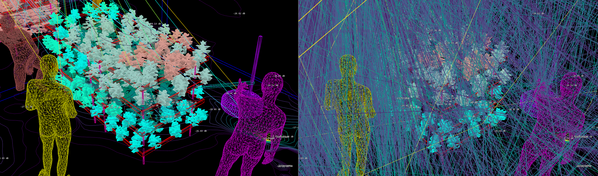
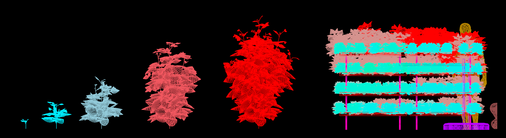
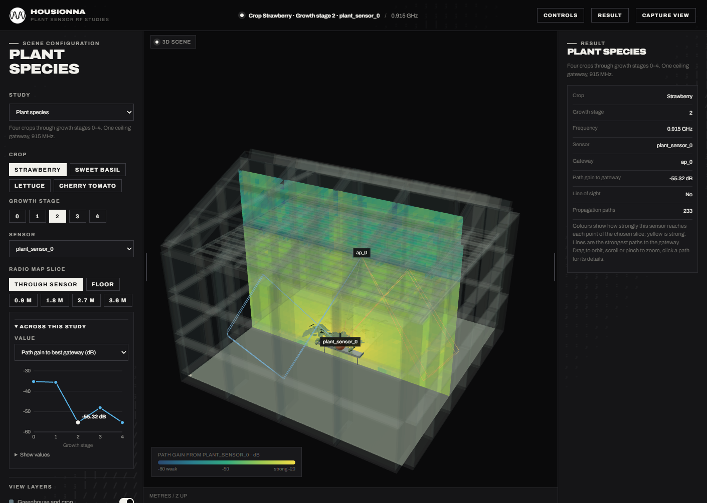

# HOUSIONNA

**Procedural radio propagation modelling for sensor networks in smart agriculture.**

HOUSIONNA connects procedural scene generation in [Houdini](https://www.sidefx.com/) with GPU radio ray tracing in [Sionna RT](https://nvlabs.github.io/sionna/rt/). It builds crops, greenhouses and devices from parameters, simulates batches of variations (species, growth stage, frequency, gateway density, leaf water content), and evaluates the results for sensor connectivity and RF energy harvesting.

**[Open the web viewer →](https://hyropa.github.io/HOUSIONNA/)**



## How it works

1. **Generate** a scene in Houdini: plants grown from L-systems in five growth stages, trays, frame, sensor nodes and gateways. A TOP network wedges the parameters into a batch of variations.
2. **Trace** every variation with Sionna RT, on your own machine or a remote GPU server, straight from buttons in Houdini.
3. **Inspect** paths and radio maps back in Houdini, or in the web viewer.
4. **Evaluate** link margins, RF power transfer and harvester charge times with the toolkit.





## Repository

| Folder | What it holds | Docs |
|---|---|---|
| [`houdini_files/`](houdini_files/) | Example scene (`.hipnc`), the Houdini plugin (`sionna/sionna_sop.py`), the solver (`sionna/sionna_run.py`) and the material library | [Plugin](houdini_files/README.md) · [Scene format and materials](houdini_files/sionna/README.md) |
| [`toolkit/`](toolkit/) | Python: run import, local viewer server, application engine, website publishing, tests | [Toolkit](toolkit/README.md) |
| [`viewer/`](viewer/) | The three.js web viewer | [Viewer](viewer/README.md) |
| [`docs/`](docs/) | The L-system rules of the four crops, readable without Houdini | [L-system rules](docs/lsystem_rules.md) |

## Quick start

Requirements: Houdini 22.0 or later (the free Apprentice edition works), Python 3.12, and optionally an NVIDIA GPU (Sionna RT also runs on the CPU).

```bash
# Solver environment, used by the Houdini buttons
python -m venv venv
venv/Scripts/pip install -r requirements.txt        # Linux/macOS: venv/bin/pip
```

Open `houdini_files/SIONNA_HOUDINI_BATCH_01-v3.hipnc` from a terminal, select the Null with the Sionna buttons at the end of the scene network and press **run**: it validates, exports, traces and imports the scene. See the [plugin README](houdini_files/README.md) for batches and remote GPU targets.

To browse the results in the web viewer:

```bash
cd toolkit
python -m venv .venv && .venv/Scripts/pip install -r requirements.txt
npm --prefix ../viewer install && npm --prefix ../viewer run build
.venv/Scripts/python run.py view                     # http://127.0.0.1:8765/viewer/
```

## Video

[](https://www.youtube.com/watch?v=GcwktsATHTg)

## Citation

J. Putteneers, B. Forrez and G. Callebaut, "Open-Source Procedural Radio Propagation Modelling for Sensor Networks in Smart Agriculture," submitted.

## License

HOUSIONNA is licensed under the GNU General Public License v3.0 or later. See [LICENSE](LICENSE).

## Acknowledgements

Developed at [DRAMCO](https://dramco.be/), Department of Electrical Engineering, KU Leuven. Supported by KU Leuven Internal Funds through HYROPA (CELSA/26/011) and a Starting Grant (STG/25/045), and by the Smart Networks and Services Joint Undertaking (SNS JU) through the European Union's Horizon Europe programme under AMBIENT-6G (Grant Agreement No. 101192113) and SUSTAIN-6G (Grant Agreement No. 101191936).
