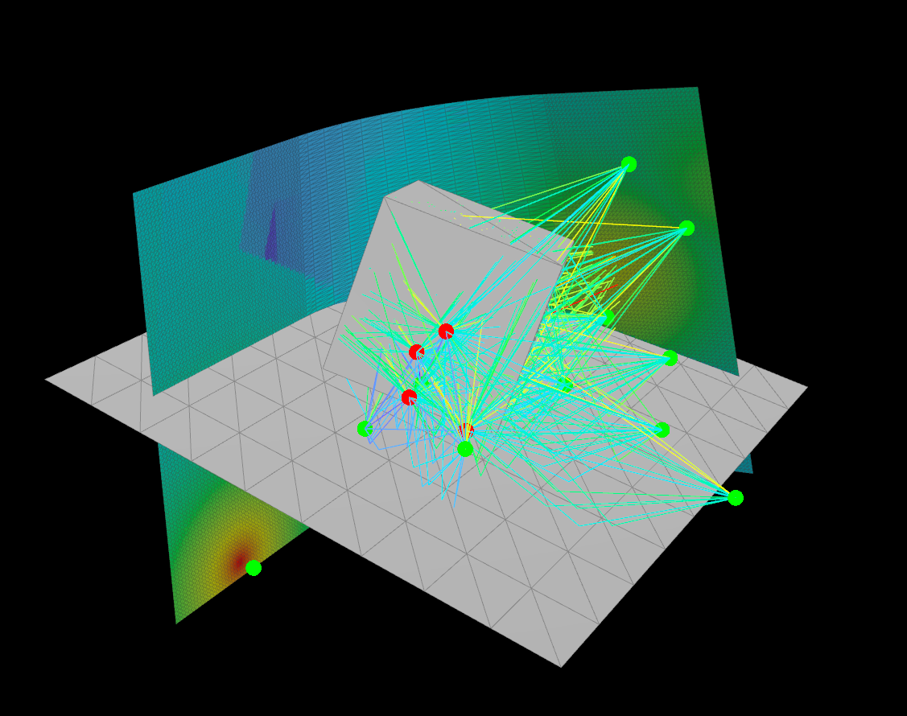

# Houdini plugin

Run [Sionna RT](https://nvlabs.github.io/sionna/rt/) radio propagation simulations from a Houdini scene, locally or on a remote GPU server, and bring the results back into Houdini as geometry with attributes.

Houdini is the procedural generator: geometry, materials and devices are built with nodes, so one network can produce many scene variations, and each variation can be simulated and inspected within seconds.



The scene format (attributes, materials) and every message code are described in [sionna/README.md](sionna/README.md).

## What it is

A set of Python functions called from buttons on one Houdini node, plus a solver script that runs in a separate Python environment, either on the same machine or on a remote GPU server over SSH. Houdini handles geometry, device placement and visualisation. Sionna RT handles the physics on the GPU.

| Button | Function | Does |
|---|---|---|
| check_spark_health | `on_check` | Reports the compute target: reachable, Sionna version, Mitsuba variant, GPU, other GPU users |
| validate_geometry | `on_validate` | Checks the scene: triangles only, names and materials set, sane units, devices present |
| export_to_files | `on_export` | Writes meshes, scene XML, materials and devices into a new timestamped run folder on this machine |
| previz_sionna_scene | `on_previz` | Copies the run folder to the target, has Sionna load it, and shows in Houdini what Sionna actually holds |
| copy_to_spark_and_solve | `on_solve` | Copies the run folder to the target, computes paths between every TX and RX and a radio map on every measurement surface, copies the results back |
| import_sionna_results | `on_import` | Loads paths, per-link results and radio maps into File SOPs |
| run | `on_run` | Validate, export, solve and import in one press; stops at the first step that fails |
| batch_export | `on_batch_export` | Exports every TOP work item from `batch_start` to `batch_end` into one batch folder |
| batch_solve | `on_batch_solve` | Sends the batch to the target and starts it there in the background; returns immediately |
| batch_status | `on_batch_status` | Progress of the running batch: solved, failed, current work item, time left |
| batch_fetch | `on_batch_fetch` | Copies the finished results of the batch back and converts them for the `sionna_batch_*` File SOPs, which show the result of the work item selected in the TOP network |
| batch_clear | `on_clear("session")` | Deletes the batches of the current `batch_name` on the target, after confirmation |
| clear_all | `on_clear("all")` | Deletes all runs and batches of this hip file on the target, after confirmation |

Export never contacts the server; previz, solve and the batch buttons except export do. The first six buttons are for testing one scene step by step; run does the same in one press.

## Folder structure

```
.
├── venv/                       local Sionna RT environment (not committed)
├── requirements.txt
└── houdini_files/
    ├── <scene>.hip
    └── sionna/
        ├── sionna_sop.py       functions called by the buttons on the Houdini node
        ├── sionna_run.py       solver script, run by the target's Python
        ├── materials.json      custom material library
        ├── log.txt             log over all runs, same text as the terminal output
        ├── previz.bgeo.sc      latest results, read by File SOPs
        ├── paths.bgeo.sc
        ├── links.bgeo.sc
        ├── radiomap.bgeo.sc
        └── data/
            └── <YYYYMMDD_HHMMSSZ>/
                ├── scene.bgeo.sc         the input geometry as exported, with all attributes; stays on this machine
                ├── meshes/<name>.ply     binary PLY, one per object name
                ├── sionna_run.py         copy of the solver used for this run
                ├── <hip>_meta.json       git commit, uncommitted changes flag, Houdini version
                ├── <hip>_scene.xml
                ├── <hip>_materials.json  resolved permittivity and conductivity per object
                ├── <hip>_txrx.json
                ├── <hip>_measure.json
                ├── <hip>_settings.json
                ├── <hip>_dump.json
                ├── <hip>_result.npz      paths and links
                ├── <hip>_radiomap.npz
                ├── <hip>_log.txt         validate and export messages of this run
                ├── solver.log            full solver output of the last solve or previz
                ├── <hip>_previz.bgeo.sc
                └── paths.bgeo.sc, links.bgeo.sc, radiomap.bgeo.sc
        └── batches/
            └── [<batch_name>_]<YYYYMMDD_HHMMSSZ>/
                ├── batch.json            TOP node, range, git commit, export status per work item
                ├── queue.json            work items sent with the last batch solve
                ├── status.json           progress, written by the solver
                ├── batch.log             solver output of all batch solves
                └── wi<index>/            one run folder per work item, as above, plus
                    ├── done.json         settings it was solved with
                    └── failed.json       error, if the solve failed
```

Every export creates a new run folder. Previz, solve and import always work on the latest one.

On a remote target the folders are mirrored to:

```
<remote_root>/
├── venv/
├── runs/<hip>/<stamp>/
└── batches/<hip>/<stamp>/
```

## Setup

Requires Houdini, and on the machine that computes: Python 3.11 or later and Sionna RT. Sionna RT 2.2.0 installs on Python 3.10 but fails on import there (`cannot import name 'Self' from 'typing'`). Sionna RT is only needed on that machine, your own PC (local target) or a server (remote target). An NVIDIA GPU is optional: without one, Sionna runs on the CPU (see Compute target).

```bash
python -m venv venv
source venv/bin/activate           # Linux; on Windows (Git Bash): venv/Scripts/activate
pip install -r requirements.txt    # sionna-rt==2.2.0
```

In Houdini:

1. Open the example scene `SIONNA_HOUDINI_BATCH_01-v3.hipnc` (the Null with all buttons is already set up), or add a Null SOP at the end of your own scene network.
2. Add one Button parm per function, with this Python callback (change only the function name):

```python
exec(open(hou.expandString('$HIP/sionna/sionna_sop.py')).read()); on_validate()
```

The code is read from `sionna/sionna_sop.py` on every press, so the file in git is the only copy. Every button first turns on the display flag of the Null if it is off (`display flag set on ...`).

Start Houdini from a terminal. All feedback is printed there and appended to `sionna/log.txt`; there are no pop-ups.

Validate and export read the geometry in bulk. To get which points belong to which triangle, they create a temporary Attribute Wrangle `sionna_scan` next to the node that feeds the Null, cook it and delete it again. This adds no undo steps, but marks the hip file as changed.

## Compute target

A string parm `target` on the Null selects where the solver runs:

- `local` (or empty): the venv on this machine, at `$HIP/../venv/bin/python3` (Windows: `$HIP/../venv/Scripts/python.exe`). Override with a string parm `python_exe`.
- an SSH host alias, e.g. `spark`: a remote server. Override the remote folder with a string parm `remote_root` (default `~/Documents/HyROPA`).

To pick the target per machine, set the parm to `$SIONNA_TARGET` and define it in each machine's `houdini.env`, e.g. `SIONNA_TARGET = spark`.

**When the Spark is not on your network, it is only reachable through the VPN.** Start it before check, previz or solve, and keep that terminal open:

```bash
sudo openvpn --config <client>.ovpn
```

Without the VPN every remote action fails after about 10 s with `T001 ... Connection timed out`. Never commit the `.ovpn` file: it contains the VPN certificate and key.

Remote setup, once per server:

1. An alias in `~/.ssh/config`:
   ```
   Host spark
       HostName <server address>
       User <user>
       IdentityFile ~/.ssh/<your key>
   ```
2. Key login, since Houdini cannot type a password: `ssh-copy-id -i ~/.ssh/<your key>.pub spark`. Never commit a private key.
3. On the server, a venv at `<remote_root>/venv` with `requirements.txt` installed. Without it, every remote action fails with `T002`.
4. `rsync` on both machines (on Windows: inside WSL, see Windows).

Each remote run checks that the server and venv exist and reads the GPU status, mirrors the run folder (without `.bgeo.sc` files) to the server, runs the solver there, and copies the results back.

### GPU or CPU

A Toggle parm `use_gpu` on the Null (default on) selects the device, on every target:

- on: Sionna runs on the GPU (CUDA). Without a usable GPU, check, solve and batch solve stop with `T003`.
- off: Sionna runs on the CPU (LLVM), locally or on the Spark. Same results, but much slower: use small tests (few TX, `samples` 1e5, `radiomap_samples` 1e6). Needs the LLVM library, version 17 or newer, on that machine; if check reports the CPU as not available (`T005`), install it (Ubuntu: `sudo apt install llvm`). Check shows the LLVM version and warns (`W013`) below 17.

With a remote target, check first prints the transfer tool (`transfer: rsync`, or `transfer: wsl --exec rsync` on Windows). Then it prints what the target has and what is selected:

```
[sionna check] target local: sionna 2.2.0
[sionna check]   gpu: not available (jit_init_thread_state(): the CUDA backend hasn't been initialized)
[sionna check]   cpu: <cpu model>, 4 threads, available, LLVM 20.1.8
[sionna check]   selected: cpu (use_gpu off)
[sionna check] N008 target 'local': sionna 2.2.0, runs on the cpu
```

### Windows

The OS is detected automatically; buttons, parms and folders are the same as on Linux.

1. Python 3.11 or later from python.org. In the project folder: `py -3.12 -m venv venv`, then `venv\Scripts\pip install -r requirements.txt`.
2. GPU (`use_gpu` on): only the NVIDIA driver.
3. CPU (`use_gpu` off, e.g. on machines without NVIDIA GPU): install LLVM for Windows with the installer from the LLVM releases, in its default folder `C:\Program Files\LLVM`. The plugin points Sionna to `C:\Program Files\LLVM\bin\LLVM-C.dll` itself; for another folder, set the environment variable `DRJIT_LIBLLVM_PATH` to that DLL. Check shows whether the CPU backend loads and its LLVM version. Not every LLVM version works on Windows: 20.1.8 loads but every CPU solve aborts with `JIT session error: Failed to materialize symbols: __real@...`. A Dr.Jit issue reports 16.0.4 working on Windows and 17.0.6 failing. On Linux, 15 aborts with `Cannot select` and 20 works.
4. Remote target: commands use the ssh of Windows, file transfers use rsync inside WSL:
   1. `C:\Users\<you>\.ssh\config` with the `spark` alias and key as above. The key file must be readable by your user only, or Windows ssh refuses it.
   2. In WSL: `sudo apt install rsync`, the same alias in WSL's `~/.ssh/config` with a copy of the key (`chmod 600`), and `ssh spark` once to accept the host key. Without that, transfers fail with `T004` and the ssh error.
   3. Check prints `transfer: wsl --exec rsync`. Without rsync in WSL it stops with `T006`.
   WSL reaches the Spark on the local network directly. Over the Windows VPN it needs mirrored networking on Windows 11: `networkingMode=mirrored` under `[wsl2]` in `%UserProfile%\.wslconfig`.
5. Local batches are started detached and keep running when Houdini closes.

Tested on Linux only, with Windows behaviour simulated (WSL rsync path and options); the Windows-only parts (process checks, detaching, LLVM lookup, CPU name) are untested.

## Batches

For many scene variations from a TOP network (e.g. a Wedge TOP), next to the Null:

1. Set the int parms `batch_start` and `batch_end` to a range of work item indices (both included; without the parms, all work items).
2. **batch_export**: for each work item in the range, selects it in the TOP network, so the SOP network cooks that variation, then validates and exports it to `batches/<batch_name>_<stamp>/wi<index>/` (see Batch names). The wedge attributes of the work item are stored in its `<hip>_meta.json`. A work item that fails validation or does not cook is recorded in `batch.json` and skipped; the others continue. The selection is restored afterwards.
3. **batch_solve**: writes the current settings into every exported work item, sends the batch folder and starts one solver process on the target, which solves all work items one after the other in one Sionna session. The button returns at once; Houdini stays usable and the job keeps running if Houdini or the laptop is closed. Houdini then checks the batch every 15 s in the background and prints a `[sionna watch]` line when work items are solved or fail, and one when the batch is finished or has stopped. It only prints; fetch is up to you. Watching ends with the batch, after 4 failed checks in a row (e.g. VPN down), or when Houdini closes; the job itself is not affected.
4. **batch_status**: prints progress while it runs.
5. **batch_fetch**: copies the results back, converts every new or changed result to `.bgeo.sc` in its `wi<index>` folder, and creates four File SOPs next to the Null: `sionna_batch_scene` (the geometry as exported for that work item, including display-only geometry), `sionna_batch_paths`, `sionna_batch_links`, `sionna_batch_radiomap`. Can be pressed while the batch is still running; press it again later for the rest.
6. Click a work item in the TOP network: the SOP network cooks that variation and the `sionna_batch_*` File SOPs load its exported geometry and results. `sionna_batch_scene` is what was simulated, also after the network has been changed since the export. Their file path is

   ```
   $HIP/sionna/batches/`chs("../<null>/batch")`/wi`padzero(3, @pdg_index)`/radiomap.bgeo.sc
   ```

   With no work item selected, or for a work item without result (failed, not solved or not fetched yet), they load nothing instead of giving an error.

The TOP node is the one with the display flag inside `../topnet1`; another can be set with a string parm `top_node`: a TOP network (its display node is used) or a TOP node, absolute or relative to the Null.

Add a string parm `batch` to the Null. Batch export writes the new batch name into it, and all batch buttons and the `sionna_batch_*` File SOPs use that batch. Without the parm the buttons use the latest batch, and the File SOPs find nothing (`W009`).

Give `batch` a menu to pick a batch: on its Menu tab "Use Menu", Replace (field and menu), Menu Script, Python:

```python
g = {}
exec(open(hou.expandString('$HIP/sionna/sionna_sop.py')).read(), g)
return g["batch_menu"]()
```

It lists the batch folders of this hip file on this machine, newest first, e.g. `pick_20261105_134219Z   6 items, 6 solved, 6 fetched, spark`: exported work items, work items with a result here (as of the last fetch for a remote batch), work items converted for the File SOPs, and where the batch was solved. Picking one switches the File SOPs at once to what was fetched of it; batch fetch updates it. Opening the menu never contacts a server.

Batch solve records where it started the batch (`solved_on` in `batch.json`). Batch status and batch fetch use that machine, also when `target` has been changed since; batches solved before this have no record and use `target`.

To fetch part of a batch, set the Integer parms `fetch_start` and `fetch_end` (work item indices, both included; `fetch_end` -1 = up to the last). The defaults 0 and -1, or no parms, fetch everything. Only those work items are copied and converted; the others stay as they are. They are separate from `batch_start` and `batch_end`, which set what batch export includes.

Fetch makes the local batch folder a copy of the remote one: a result that no longer exists on the target (work item solved again and failed, or being solved) is removed locally too, with its `.bgeo.sc` files.

Pressing batch_solve again resumes: work items already solved with the same settings are skipped, failed ones are tried again. After a settings change all work items are solved again. A batch cannot be started twice at the same time (`B004`). A failed work item does not stop the batch; its error is in `failed.json`, `batch_status` and `batch.log`.

To stop a running batch: `ssh spark`, then `kill <pid>` with the pid printed by batch_solve (also in `batch.pid` in the remote batch folder).

### Batch names

A string parm `batch_name` on the Null groups batches into sessions, e.g. `plants_on` and `plants_off`. Batch export names the folder `<batch_name>_<YYYYMMDD_HHMMSSZ>`, or only the timestamp when `batch_name` is empty. Letters, digits, `_` and `-` only (`B009`).

### Settings per work item

Any solver setting can follow the work item. Give the wedge an attribute and put an expression on the Null's parm, e.g. `@frequency`, `@samples`, `@max_depth`; in a string parm, type the attribute reference as text, e.g. `@tx_pattern` in `base_tx_antenna_pattern` (a string parm counts as per work item when its text contains `@` or a backtick). A parm with an expression is evaluated for every work item at batch export, after selecting it, and stored with that work item; a parm with a plain value is read at batch solve, as before, so it can still be changed and solved again without exporting. The export line shows the values per work item (`wi003: exported, 5.18 GHz, samples 100000, ...`), batch solve lists which settings came from the work items.

This applies to `frequency`, `max_depth`, `samples`, `max_paths_per_tx`, `los`, `specular_reflection`, `refraction`, `diffuse_reflection`, `diffraction`, `radiomap_samples`, `bandwidth`, `cfr_points`, `seed` and the four `base_*` antenna parms. Antennas set as point attributes follow the work item through the SOP network anyway. `target`, `use_gpu` and `timeout` belong to the whole batch.

- `frequency` is always taken at export, also as a plain value, because the materials are computed for it. Batch solve uses the frequency each work item was exported with; to solve at another frequency, export again.
- Values are checked at export and at solve (`S012`); a work item with an invalid value is not exported or not queued.
- With an expression and no work item selected, the parm has no value: validate, export and single solves stop with `V013` for `frequency`; other settings fall back to their default.
- Presets leave parms with an expression unchanged (`W015`).
- Changing the value of an expression parm needs a new batch export.

### Clearing

Both buttons work on the selected `target` only: local deletes folders on this machine, a remote target deletes them on that machine, never both. When the remote target is not reachable they stop with `T001`.

- **batch_clear**: all batches of this hip file with the current `batch_name`, any timestamp. With `batch_name` empty: the batches without a name.
- **clear_all**: all single runs (`data/`, or `runs/<hip>/` remotely) and all batches of this hip file. Folders of other hip files in the same `sionna/` folder are kept.

The folders and their size are listed in the terminal and in a dialog; nothing is deleted until you press Delete. A batch that is still running is kept (`W014`). File SOPs that pointed at deleted results load nothing.

## Settings

Defaults, each overridable by a parm of the same name on the Null:

| Parm | Default | Meaning |
|---|---|---|
| `frequency` | 3.5e9 | Carrier frequency in Hz. Sets the wavelength and all material values. Changing it requires a new export. |
| `max_depth` | 3 | Maximum number of interactions per path (reflections, transmissions, scattering). Higher finds more paths and is slower. Passing through a closed box costs 2. |
| `samples` | 1000000 | Rays launched per TX when searching for paths. More rays miss fewer paths. |
| `max_paths_per_tx` | 100000 | Upper limit on paths kept per TX. Limits GPU memory. |
| `los` | on | Include the direct path |
| `specular_reflection` | on | Mirror-like reflections |
| `refraction` | on | Transmission through surfaces |
| `diffuse_reflection` | off | Diffuse scattering. Needs `scattering_coefficient` > 0 on materials. |
| `diffraction` | off | First-order edge diffraction (Sionna supports first order only) |
| `bandwidth` | 100e6 | Width in Hz of the per-link frequency response `cfr_db`, centred on `frequency` |
| `cfr_points` | 256 | Number of frequencies in `cfr_db`. 0 skips the frequency response; it is the largest part of the paths result. |
| `radiomap_samples` | 10000000 | Rays per TX for the radio map. More rays give less noise per cell. `radiomap_samples` × number of TX must stay below 4.29e9 (Sionna limit), otherwise solve stops with `S010`. |
| `seed` | 42 | Random seed of the path solver and the radio map (Sionna's default). The same seed gives the same result; other seeds show the sampling noise. Stored with every run. |
| `base_tx_antenna_pattern`, `base_rx_antenna_pattern` | iso | Antenna of the TX and of the RX points: `iso`, `dipole`, `hw_dipole` (half-wave dipole) or `tr38901` (3GPP panel element). Used for every point of that role without its own `antenna_pattern` attribute. With a pattern other than `iso`, the device `orientation` matters. Radio maps apply the TX antenna only. |
| `base_tx_polarization`, `base_rx_polarization` | V | `V` or `H`, for every point of that role without its own `polarization` attribute. |
| `target` | local | Where the solver runs: `local` or an SSH alias |
| `remote_root` | ~/Documents/HyROPA | Folder on the remote target that holds `venv/` and `runs/` |
| `timeout` | 1800 | Seconds before a previz or solve is aborted |
| `quality`, `band`, `antenna` | none | Menus that set a group of parms at once, see Presets |
| `use_gpu` | on | Toggle. On: run on the GPU (CUDA). Off: run on the CPU (LLVM), locally or on the Spark |
| `python_exe` | `$HIP/../venv/bin/python3` | Python for the local target |
| `batch_start`, `batch_end` | all | Range of work item indices for batch export |
| `top_node` | display node in `../topnet1` | TOP node whose work items are exported |
| `batch` | set by batch export | Batch folder name used by the batch buttons and the `sionna_batch_*` File SOPs; with a menu to pick one, see Batches |
| `fetch_start`, `fetch_end` | 0, -1 (all) | Range of work item indices that batch fetch copies and converts |
| `batch_name` | empty | Session name in front of the batch timestamp; also selects what batch_clear deletes |

### Presets

`PRESETS` at the top of `sionna_sop.py` holds three independent sets of named parm values, each with its own menu on the Null (every quality preset also sets `seed` to 42):

- `quality`: target, `use_gpu`, ray and depth settings, interaction toggles, `timeout`.
- `band`: `frequency` and `bandwidth`.
- `antenna`: the four `base_*` antenna parms.

None sets another's parms, so any quality, band and antenna can be combined. Parms that are not on the Null are listed (`W012`) and left alone. Edit the dict to change or add presets; the menus follow it.

| Quality | For |
|---|---|
| `laptop_test` | Small tests on the laptop CPU (`target` local, `use_gpu` off) |
| `spark_quick` | Fast check on the Spark |
| `spark_standard` | Normal single runs |
| `dense_canopy` | Paths through plants: `max_depth` 8, more rays |
| `batch` | Many variations: no frequency response, fewer radio map rays |
| `final` | Highest accuracy, diffraction on |

| Band | `frequency` | `bandwidth` |
|---|---|---|
| `lora_868` | 868 MHz | 125 kHz |
| `lora_915` | 915 MHz | 125 kHz |
| `wifi_2g4` | 2.437 GHz (channel 6) | 20 MHz |
| `wifi_5g` | 5.18 GHz (channel 36) | 20 MHz |

Setup on the Null: two String parms, `quality` and `band`. On the Menu tab of each: "Use Menu", Menu Script, Python:

```python
g = {}
exec(open(hou.expandString('$HIP/sionna/sionna_sop.py')).read(), g)
return g["preset_menu"]("quality")
```

and as callback script (Python), so a choice is applied immediately:

```python
exec(open(hou.expandString('$HIP/sionna/sionna_sop.py')).read()); on_preset("quality")
```

For `band` and `antenna`, replace `"quality"` with `"band"` or `"antenna"` in both.

| Antenna | TX (sensors) | RX (gateway) | For |
|---|---|---|---|
| `iso_reference` | iso V | iso V | propagation only, no antenna effects |
| `dipole_link` | dipole V | dipole V | simple sensors and gateway |
| `sensor_dipole_panel` | dipole V | tr38901 V | dipole sensors, panel gateway (WPT reader); aim the panel with `orientation` |
| `half_wave_link` | hw_dipole V | hw_dipole V | half-wave dipoles on both sides |
| `cross_pol` | dipole V | dipole H | polarisation mismatch |

## Terminal output

Every message, including all error and warning codes, is printed to the terminal and appended to `sionna/log.txt` with a timestamp. Each button ends with a line such as `solve passed (0 errors, 1 warning) after 21.4 s` or `export FAILED (2 errors, 0 warnings) after 0.3 s`; the time counts from the button press.

| Button | Prints |
|---|---|
| check | target, Sionna version, GPU (name, load) and CPU (model, threads) with their availability, selected device |
| validate | objects, triangles and object count per material, radio map surfaces, devices, frequency and wavelength, scene size |
| export | run folder, every file written with its size, permittivity and conductivity per material at the run frequency, git commit |
| previz | files sent and received, Sionna's own progress, what Sionna loaded |
| solve | files sent and received, Sionna's progress per step with timings, number of paths and radio map cells |
| import | gain range of the paths, number of line-of-sight paths, radio map signal range, cells without signal, time taken |
| run | the output of validate, export, solve and import, then the total time |
| batch export | one line per work item: status, primitive count, warning and error codes, time |
| batch solve | work items queued, files sent, pid of the started job |
| batch status | running, finished or stopped; solved, skipped and failed counts; current work item; seconds per work item and time left; errors of failed work items; last lines of `batch.log` |
| batch fetch | files received and removed, work items converted to bgeo with time, number of results |
| watch | work items solved or failed since the last check, then finished or stopped with totals |
| clear | folders found with size (running ones marked), then the number deleted |

## Results

**`sionna_paths`**: one polyline per propagation path, from TX through every interaction point to RX.
Prim: `tx`, `rx`, `gain_db`, `tau` (delay, s), `a_re`, `a_im` (complex amplitude), `bounces`, `theta_t`, `phi_t` (departure angles, rad), `theta_r`, `phi_r` (arrival angles, rad), `doppler` (Hz). Angles are in Sionna's frame (z up).
Point: `interaction` (1 specular, 2 diffuse, 4 refraction, 8 diffraction), `object` (name of the object hit), `primitive` (triangle index hit).

**`sionna_links`**: one line per TX/RX pair, summarising all its paths.
Prim: `num_paths`, `gain_db_coherent` (paths added with phase: the value at exactly that position), `gain_db_incoherent` (powers added: the local average), `delay_spread` (RMS, s), `cfr_db` (array: gain per frequency). Detail: `cfr_frequencies`.

**`sionna_radiomap`**: the measurement triangles.
Prim: `path_gain_db` (array, one entry per TX, in the order of detail `tx`), `path_gain_db_max` (strongest TX), `best_tx`, `best_tx_name`, `name`. Detail: `tx`.
The radio map adds powers without phase and averages over each cell, so it shows the local average, not small-scale fading.

Missing values are stored as -999.

Solve writes the results as compressed NumPy files (float32), about 10 times smaller than JSON and read without parsing. Import turns them into the geometry above. They can also be read directly, e.g. for analysis over a batch:

```python
import numpy as np
d = np.load("wi015/<hip>_result.npz")
d["link_gain_db_incoherent"]   # [rx, tx], order of d["rx"] and d["tx"]
```

| File | Arrays |
|---|---|
| `_result.npz` | `tx`, `rx` (names), `tx_position`, `rx_position`, `object_names`, `cfr_frequencies`, `info` (JSON: Sionna version, settings). Per path, in rx, tx order: `path_tx`, `path_rx` (indices), `path_interactions`, `path_objects` (index into `object_names`, -1 none), `path_primitives`, `path_vertices` ([path, depth] and [path, depth, 3], unused depths 0), `path_gain_db`, `path_tau`, `path_a_re`, `path_a_im`, `path_theta_t`, `path_phi_t`, `path_theta_r`, `path_phi_r`, `path_doppler`. Per link [rx, tx]: `link_num_paths`, `link_gain_db_coherent`, `link_gain_db_incoherent`, `link_delay_spread`, `link_cfr_db` ([rx, tx, frequency]) |
| `_radiomap.npz` | `tx`, `map_names`, `vertices`, `faces` (all surfaces together), `cell_map` (surface index per cell), `path_gain_db` ([cell, tx]), `info` |

Positions are in Sionna axes (z up).

## Plant models (L-systems)

Plants are generated with Houdini's L-system SOP, with rules written for this project, in five growth stages (0 to 4). Formalism: P. Prusinkiewicz and A. Lindenmayer, *The Algorithmic Beauty of Plants*, Springer, 1990. Rules are in L-system SOP syntax; a trailing `:p` is the probability of a stochastic rule.

| Plant | Premise | # | Rule |
|---|---|---|---|
| Strawberry | `A` | 1 | `A=/(137.5)[&(25)B(0)&(60)J(0.1)[+(45)J(0.1)][-(45)J(0.1)]]F(0.005)A:0.5` |
| | | 2 | `A=/(137.5)[&(10)E(0)&(75)J(0.1)[+(45)J(0.1)][-(45)J(0.1)]]F(0.005)A:0.3` |
| | | 3 | `A=/(137.5)[&(35)C(0)[&(35)D(0)M(0.2)][^(35)D(0)M(0.2)]C(0)M(0.25)]F(0.005)A:0.2` |
| | | 4 | `B(n):n<6=F(0.2)TB(n+1)` |
| | | 5 | `E(n):n<8=F(0.2)TE(n+1)` |
| | | 6 | `C(n):n<3=F(0.2)TC(n+1)` |
| | | 7 | `D(n):n<2=F(0.15)TD(n+1)` |
| | | 8 | `J(s):s<0.7=J(s+0.1)` |
| | | 9 | `M(s):s<0.4=M(s+0.1)` |
| | | 10 | `M(s):s>=0.4=TTTTTTTTK(0.2)` |
| | | 16 | `K(s):s<0.35=K(s+0.05)` |
| Sweet basil | `A` | 1 | `A=F(0.05)T[&(20)TJ(0.2)]/(180)[&(20)TJ(0.2)]/(90)A:0.6` |
| | | 2 | `A=F(0.05)T[&(20)TJ(0.2)][^(-30)B]/(180)[&(20)TJ(0.2)]/(90)A:0.25` |
| | | 3 | `A=F(0.05)T[&(20)TJ(0.2)][^(-30)B]/(180)[&(20)TJ(0.2)][^(-30)B]/(90)A:0.15` |
| | | 4 | `F(l):l<0.3=F(l+0.06)` |
| | | 5 | `J(s):s<1.1=J(s+0.2)` |
| | | 6 | `&(a):a<70=&(a+10)` |
| | | 7 | `B=C` |
| | | 8 | `C=A` |
| Kropsla (butterhead lettuce) | `A` | 1 | `A=/(137.5)[&(10)J(0.1)]F(0.01)A` |
| | | 2 | `J(s):s<1=J(s+0.12)` |
| | | 3 | `&(a):a<75=&(a+8)` |
| Cherry tomato | `A(0)` | 1 | `A(n):n<2=C(0)/(137.5)[&(50)F(0.1)TE(0)][&(30)B]A(n+1)` |
| | | 2 | `A(n):n>=2=C(0)/(137.5)[&(50)F(0.1)TE(0)][&(30)B][^(40)W(0)D(0)]A(0)` |
| | | 3 | `B=A(0):0.05` |
| | | 4 | `B=B:0.95` |
| | | 5 | `C(n):n<2=F(0.12)C(n+1)` |
| | | 6 | `E(n):n<3=F(0.15)T[+(60)J(0.1)][-(60)J(0.1)]E(n+1)` |
| | | 7 | `E(n):n>=3=J(0.1)` |
| | | 8 | `D(n):n<4=F(0.08)T[&(60)F(0.05)TM(0.1)]/(180)D(n+1)` |
| | | 9 | `J(s):s<0.6=J(s+0.1)` |
| | | 10 | `M(s):s<0.2=M(s+0.1)` |
| | | 11 | `M(s):s>=0.2=TTTTTTTTK(0.15)` |
| | | 12 | `K(s):s<0.3=K(s+0.05)` |
| | | 13 | `W(n):n<10=TW(n+1)` |

## Tests

Analytic cases with known answers. Each should get its own hip file in `tests/`. Positions are given in Sionna coordinates (z up) with y = 0, so in Houdini a Sionna point (x, 0, z) is (x, z, 0). Frequency 3.5 GHz (wavelength 8.565 cm) unless stated. Expected values are computed independently: free-space loss with Friis, the wall with the exact plane-wave slab formula, concrete parameters from the ITU table above.

**A. Free space.** TX (0, 0, 2), RX (10, 0, 2). No geometry; a measurement plane 20 × 20 m at z = 0, centred under the TX, about 0.25 m cells.
- one path, `bounces` 0, `gain_db` −63.33 dB, `tau` 33.36 ns
- radio map: every cell equals free-space loss to the TX, e.g. −49.35 dB directly below it (2 m), −66.43 dB in the far corners (14.28 m). Compute `diff_db` per cell (see below): expect values scattered around 0 dB, the scatter shrinking as `radiomap_samples` grows. A systematic offset means an error.

**B. Ground reflection.** As A, with a `metal` plane 40 × 40 m at z = 0 (`thickness` 0.01) and the measurement plane moved to z = 1.
- two paths: line of sight −63.33 dB at 33.36 ns, and one specular reflection off the plane at (5, 0, 0), about −63.97 dB at 35.93 ns
- `gain_db_incoherent` of the link about −60.63 dB

**C. Wall transmission.** TX (0, 0, 2), RX (6, 0, 2). A `concrete` wall in the plane x = 3, 10 m wide (y −5 to 5), 4 m high (z 0 to 4), `thickness` 0.2. No floor.
- one path with `interaction` 4 (refraction), `gain_db` about −77.91 dB: −58.89 dB free space minus 19.02 dB through 0.2 m concrete (σ 0.123 S/m)

**D. Frequency scaling.** Test A at 2.4 GHz: the path is 3.28 dB stronger, −60.05 dB.

**E. Pipeline failures.** Expected codes: VPN off → `T001`; `remote_root` pointing to a folder without venv → `T002`; frequency changed after export → `S008`; open polygon or quad → `V003`; no RX and no measurement surface → `V107`.

**F. Canopy representations (study, not pass/fail).** A TX and RX with a canopy block between them, depth 0 to several metres, at 433 MHz, 868 MHz, 2.4 GHz and 5 GHz. Compare three representations (closed shell, stacked internal sheets, stochastic small triangles) against ITU-R P.833 and published greenhouse measurements. Expected: loss grows with depth; which representation gets the slope right is the question.

**G. CPU.** Test C with `use_gpu` off on a machine without GPU: same path, −77.91 dB, and −49.36 dB in the radio map cell under the TX (checked).

Radio map check per cell (Primitive Wrangle on `sionna_radiomap`, scene with TX points in the second input; set the wavelength for other frequencies):

```c
int tx = findattribval(1, "point", "name", s@best_tx_name);
if (tx >= 0) {
    float d = distance(@P, point(1, "P", tx));
    f@friis_db = 20 * log10(0.08565 / (4 * PI * d));
    f@diff_db = f@path_gain_db_max - f@friis_db;
}
```

## Current limitations

- **Below 1 GHz most building materials are extrapolated** (`W010`). For concrete the extrapolation still matches 3GPP (see Materials); for ground use the `soil_*` materials.
- **Some library values are unverified** (`W005`): leaf, stem, fruit, polycarbonate, polyethylene film, PVC, rockwool, and the lab fits for brick and concrete.
- **Sionna drops paths with a segment shorter than 1 cm** (`MIN_SEGMENT_LENGTH` in `sionna/rt/constants.py`). In paths and links, a closed object thinner than 1 cm (e.g. a thin stem modelled as a tube) blocks every path through it, as do two surfaces less than 1 cm apart along a ray, and a TX or RX within 1 cm of a surface. The radio map applies this limit only to diffraction, so there thin closed objects let rays through. Keep devices at least 1 to 2 cm from surfaces; model thin stems as single surfaces or leave them out.
- **No volumetric media.** Materials live on surfaces, so canopies must be built from surfaces; see test F.
- **Houdini is blocked while previz, solve or run is busy.** Batch solve runs in the background.
- **Radio maps grow with cells × TX**: 4 bytes per value, so 100,000 cells and 100 TX is 40 MB before compression.
- **GPU memory grows with TX × samples.** Every solve, and every work item of a batch, runs in its own process, so it starts with an empty GPU and a crash ends only that item. When a solve runs out of memory, the solver halves the number of TX per call and retries, down to 1 TX, for paths and radio maps separately (`out of memory, retrying with N tx per call`). When the GPU runs out of memory in a way Dr.Jit cannot recover from, the process ends; the solver restarts the work item with half the TX per call of the call that failed (`process ran out of memory with N tx per call, restarting with M`). A size found this way is passed to the next work items of a batch at 3/4, as safety margin, as rays per call (TX × samples), so it also fits work items with other `samples`. Dr.Jit's memory cache is cleared after every call. Paths come out identical to one call. Radio maps differ only by sampling noise (tested: the same spread as changing the random seed), because the rays are drawn per call. A work item fails only when 1 TX per call does not fit.
- **Validation does not check** whether a device sits inside an object or below a floor.
- **One antenna per role.** All TX share one antenna and all RX share one, as in Sionna. Several antenna types within one role would need a solve per antenna group; not implemented.
- **Aiming antennas** works only through `orientation` angles in Sionna's convention. A `look_at` point attribute (aim a device at a position, e.g. a panel gateway at the canopy centre) is planned. Dual polarisation (`VH`, `cross`) is not supported.
- **Remote targets need `ssh` and `rsync`** on your machine: standard on Linux; on Windows, rsync runs inside WSL (see Windows).
- Developed against Sionna RT 2.2.0.
