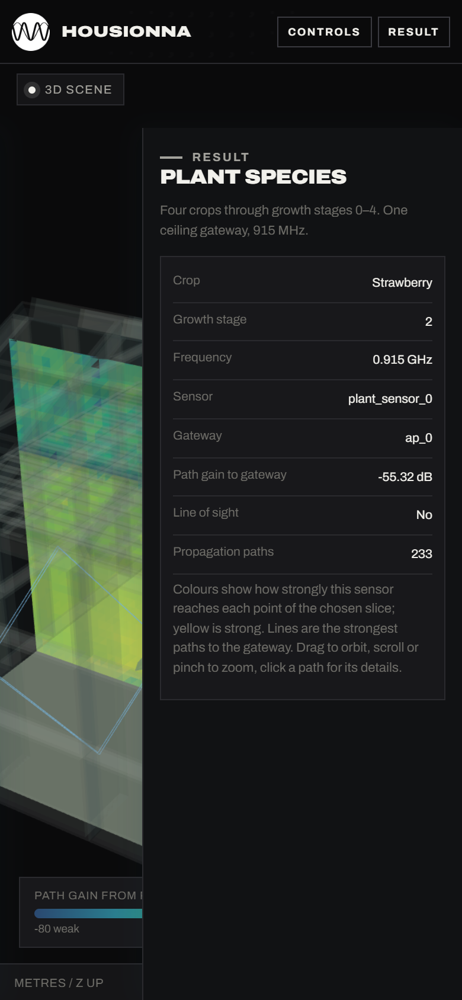

# HOUSIONNA viewer

The three.js web app that shows HOUSIONNA runs: scene geometry, propagation paths, radio maps and link metrics, per sensor and across the runs of a batch.



```bash
npm install
npm run build      # writes dist/
```

It has two modes:

- **Simple** (the default, and the public website): pick a study, click through its parameters (crop, growth stage, frequency, number of gateways, leaf water content), and see one radio-map slice with the strongest paths and a short result card. The studies are listed in [`src/studies.js`](src/studies.js); change the batch ids there to show other batches.
- **Advanced** (`?advanced` after the local URL): every run, transmitter and receiver, all paths, diagnostics, and on-demand Sionna reruns of an imported scene.

It runs in two ways:

- **Locally**, served together with the run importer and the simulation API by `../toolkit`: `python run.py view`, then http://127.0.0.1:8765/viewer/.
- **As a read-only website**: `python run.py publish` in `../toolkit` copies `dist/` together with the published runs into a static site for GitHub Pages or any web host. See the [toolkit README](../toolkit/README.md#public-website-read-only).

Source: `src/main.js` (the app), `src/studies.js` (the studies and how their parameters are labelled), `src/rf-inputs.js` (RF parameter checks), `src/*.css` (style).
